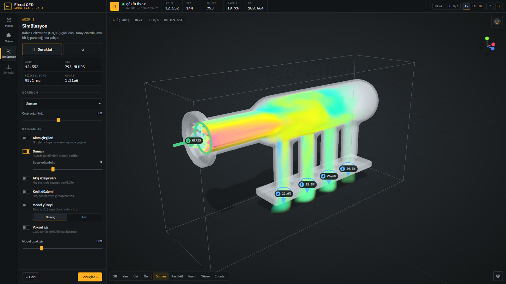
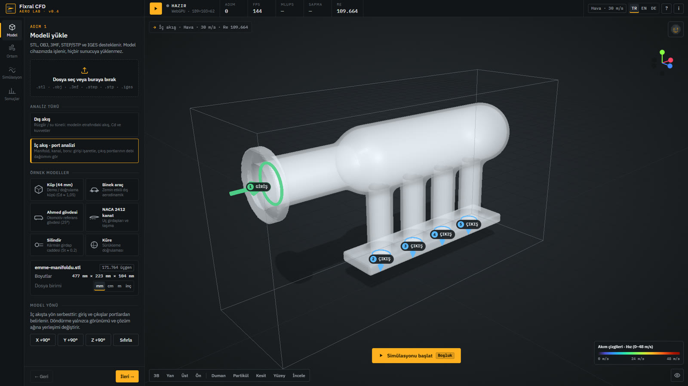
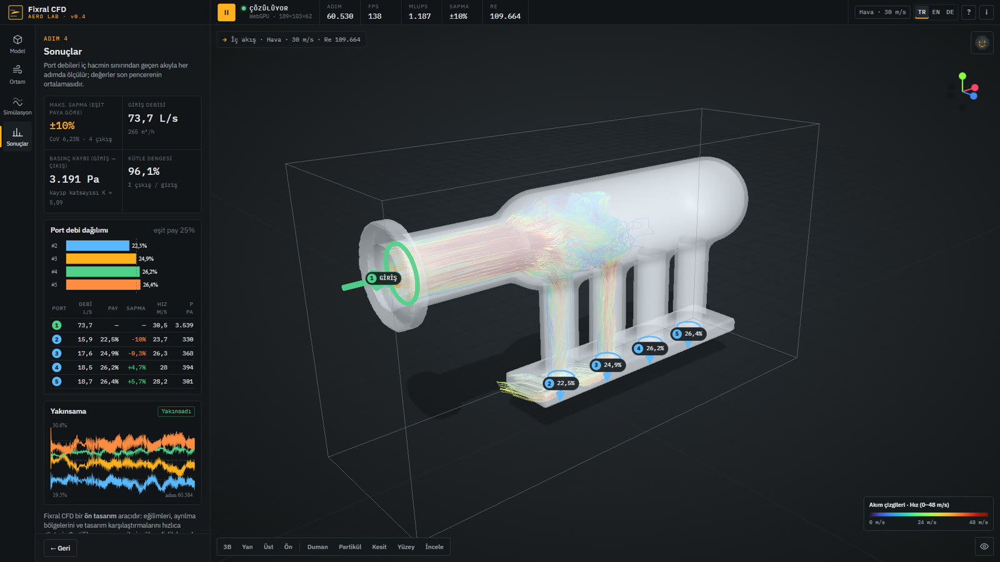
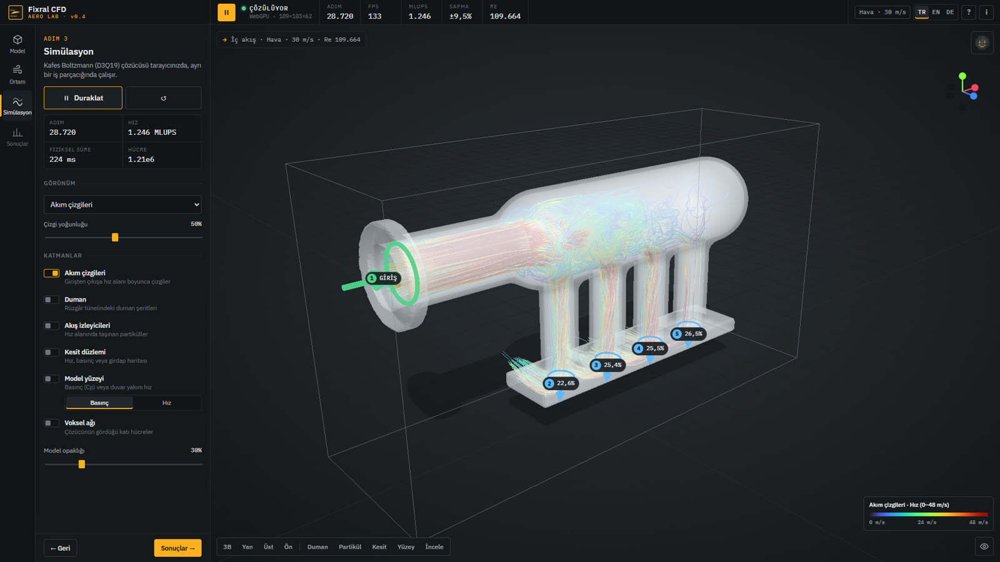
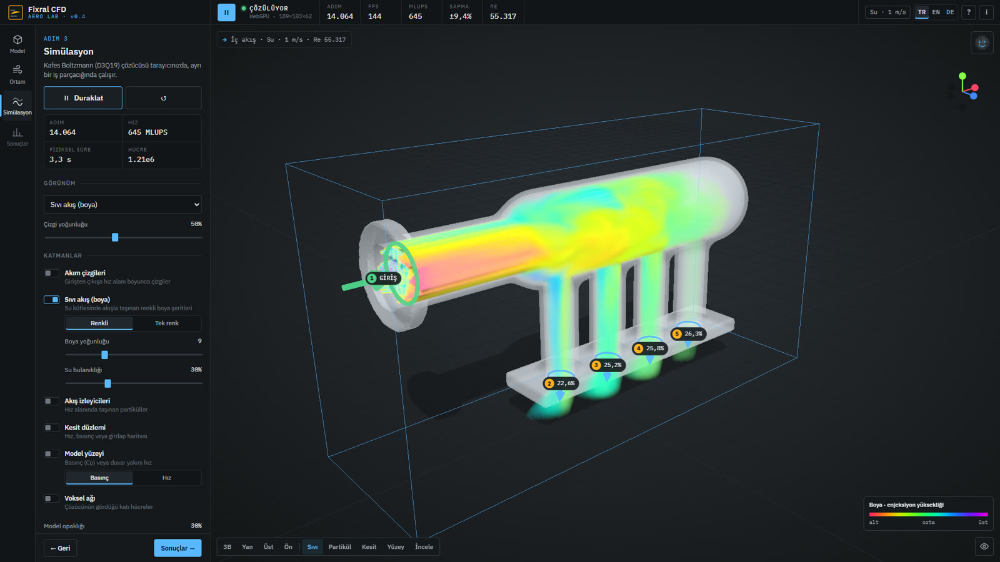

# Fixral CFD Simulator · Aero Lab

**Tarayıcıda hava ve su akış simülasyonu.** Ücretsiz, kurulumsuz, online rüzgâr ve su tüneli. STL, OBJ, 3MF veya STEP modelini yükle; sürükleme ve taşıma katsayısını, kuvveti, basınç dağılımını, akım çizgilerini ve serbest yüzeyli suyu WebGPU ile anında gör. **Yeni (v0.4):** manifold, boru, kanal gibi içi boş parçalarda **iç akış · port analizi** — girişi işaretle, hangi porttan ne kadar akış çıktığını gör.

**Free in-browser airflow and water simulation (CFD).** An online wind and water tunnel for STL, OBJ, 3MF and STEP models: drag and lift coefficients, forces, pressure distribution, streamlines and free-surface water, GPU-accelerated with WebGPU. **New in v0.4:** internal-flow port analysis for manifolds, pipes and ducts — mark the inlet and see how the flow splits across every opening. No install, no account, your files never leave your device.

### [▶ Canlı uygulamayı aç / Open the live app](https://fixral3d.github.io/fixral-cfd-simulator/)

---

## Neden Fixral CFD?

- **Kurulum yok, hesap yok:** Bağlantıyı aç ve kullan. CFD yazılımı lisansı, sunucu ya da bulut kredisi gerekmez.
- **Dosyan senin:** Model hiçbir sunucuya yüklenmez. Vokselleştirme, çözücü ve görselleştirme tamamen tarayıcında çalışır.
- **Gerçek fizik, ekran kartı hızında:** WebGPU üzerinde 3B Kafes Boltzmann (D3Q19, LES) ile saniyede 1 milyardan fazla hücre güncellemesi; serbest yüzeyli su için 340 bine kadar partikül (MLS-MPM).
- **Hava ve su:** Rüzgâr tüneli, tamamen batık su, açık kanal ve dışarıdan gelen su akıntısı tek uygulamada.
- **Dış akış ve iç akış:** Modelin etrafındaki akışın yanında, içi boş parçaların (manifold, boru, kanal, dağıtıcı) içinden geçen akışı da çözer; port başına debi dağılımını ölçer.
- **Rehberli ve çok dilli:** Asistan Vorti programı adım adım anlatır; arayüz Türkçe, İngilizce ve Almanca.
- **Anlaşılır sonuç:** Cd, Cl, Newton ve kgf cinsinden kuvvet, sürükleme gücü, Reynolds ve Froude sayısı; PNG, CSV ve JSON dışa aktarma.

## Yeni · İç akış ve port analizi (v0.4)

Bir parçanın **içinden** geçen akışı test et: emme manifoldu, egzoz kolektörü, boru dağıtıcı (manifold), hava kanalı, valf gövdesi, nozul, sıvı dağıtım bloğu… İçi boş ve açıklıkları olan her parça olur. Klasik "duman testi", "hava testi" veya "sıvı testi"ni tarayıcıda, kurulum olmadan yaparsın.

### Nasıl kullanılır?

| Adım | Ne olur? |
|---|---|
| **1 · Analiz türü** | Adım 1'de **İç akış · port analizi**'ni seç ve parçanı yükle (STL, OBJ, 3MF, STEP, IGES). |
| **2 · Portlar otomatik bulunur** | Parça vokselleştirilir, iç hacmi ve tüm açıklıkları (portlar) saniyeler içinde tespit edilir. Her açıklık sahnede numaralı bir halka, ok ve etiketle işaretlenir; listede çapı görünür. |
| **3 · İşaretle** | Varsayılan olarak en büyük açıklık **giriş**, diğerleri **çıkış**tır. Rolü sahnedeki etikete tıklayarak (çıkış → giriş → kapalı) ya da Adım 2'deki port listesinden değiştir. Kullanmadığın portları (vakum hattı, sensör deliği) **kapat**. Birden fazla giriş seçilebilir. |
| **4 · Debiyi ver** | Giriş hızını (m/s, km/h, mph…) ya da doğrudan **giriş debisini** (L/s, m³/h, L/min, CFM) gir. Hava veya su seç. |
| **5 · Çalıştır** | Parçanın çevresi atmosfere açıktır; akışın nereden ne kadar çıkacağını simülasyon kendisi belirler. Duman, akım çizgileri, partiküller ve kesit düzlemiyle akışı parçanın **duvarlarının içinden** izle. |
| **6 · Sonuçları oku** | Port başına debi ve pay, eşit paydan sapma, hız, basınç; dağılım düzgünlüğü, basınç kaybı ve kütle dengesi. CSV ve JSON olarak indir. |

### Hangi sonuçları verir?

| Sonuç | Açıklama |
|---|---|
| **Port debisi** | Her açıklıktan geçen hacimsel debi (L/s). İç hacmin sınırından geçen akı her adımda ölçülür, son zaman penceresinde ortalanır. |
| **Pay ve sapma** | Her çıkışın toplam çıkış debisindeki payı (%) ve eşit paydan sapması (ör. 4 runner'da eşit pay %25). Sahnede her portun üstünde canlı % etiketi. |
| **Dağılım düzgünlüğü** | En büyük sapma (±%) ve varyasyon katsayısı (CoV). Runner'lar arası dengesizliği tek sayıyla gösterir. |
| **Basınç kaybı** | Giriş ile çıkışların ortalama basınç farkı (Pa) ve kayıp katsayısı K = Δp / (½ρU²). |
| **Kütle dengesi** | Σ çıkış / giriş. Ölçümün tutarlılığını gösterir (tipik %95–97). |
| **Port hızı ve basıncı** | Her açıklıkta ortalama hız ve gösterge basıncı. |
| **Yakınsama** | Çıkış paylarının zaman geçmişi; paylar oturunca **Yakınsadı** etiketi. |

### Duman, hava ve sıvı testi

- **Duman testi:** Duman girişten verilir; renkler girişin kesitindeki konuma göre değişir. Hangi akış şeridinin hangi porta gittiği, plenumda nerede karıştığı ve ölü bölgeler görünür. Parça yarı saydamdır, duman duvarların içinden izlenir.
- **Hava testi:** Akım çizgileri ve partiküller giriş portundan başlar; kesit düzlemi iç hacimdeki hız, basınç ve girdap alanını gösterir.
- **Sıvı testi:** Akışkanı **su** seç: boru tamamen dolu sıvı akışı çözülür (viskozite ayarlanabilir).
- **"Ya şu portu kapatsam?"**: Bir portu tek tıkla kapat, yeniden çalıştır; debinin kalan portlara nasıl dağıldığını gör.

### İyi sonuç için ipuçları

- Model **içi boş** olmalı ve en az iki açıklığı bulunmalı. Kapalı (dolu) parçalarda iç hacim bulunamaz, uyarı çıkar.
- Portların çapı ağda **en az ~8 hücre** olmalı. Dar portlarda arayüz uyarır; **Hassas** veya **Ultra** ağı seç (WebGPU).
- Birbirine çok yakın, kısa portlar tek port olarak birleşebilir; bu durumda modeli daha hassas ağda çalıştır.
- Sonuçlar ön tasarım içindir: runner dengesizliğini, tasarım A/B karşılaştırmalarını ve sorunlu bölgeleri hızlıca gösterir.

## Nasıl çalışır?

| Adım | Ne yapar? |
|---|---|
| **1 · Model** | Analiz türünü seç: **Dış akış** (rüzgâr / su tüneli) veya **İç akış · port analizi**. STL, OBJ, 3MF, STEP/STP veya IGES dosyasını sürükle ya da hazır örneklerden birini seç (araç, Ahmed gövdesi, NACA 2412 kanat, silindir, küre, 44 mm küp). Birimi (mm/cm/m/inç) seç, modeli döndür, hücum ve sapma açısını ayarla. |
| **2 · Ortam** | Akışkanı seç (hava / su), hızı istediğin birimle gir (m/s, km/h, mph, knot, ft/s), akış yönünü belirle (±X, ±Y, ±Z). Suda ortamı seç: kanal / kutu, dış kaynaklı akıntı veya tamamen batık. Su yüksekliği, akıntı genişliği, viskozite ve kalite ayarlanır. |
| **3 · Simülasyon** | Başlat'a bas. Model hücrelere dönüştürülür, çözücü ekran kartında çalışır, akış canlı çizilir. Görünüm seçiciyle akım çizgileri, yüzey basıncı, yüzey hızı, boya, kesit veya su yüzeyi arasında geçiş yap. |
| **4 · Sonuçlar** | Dış akışta sürükleme ve taşıma katsayısı, kuvvetler, sürükleme gücü, en yüksek hız, basınç aralığı, kavitasyon riski (su). İç akışta port başına debi, pay, sapma, basınç kaybı ve kütle dengesi. Yakınsama grafiği; PNG, CSV ve JSON olarak indir. |

## Vorti — akış asistanın

Uygulamayı ilk açtığında **Vorti** karşılar: nokta matrisli yüzü olan, göz kırpan ve konuşurken ağzı oynayan küçük bir rehber. 11 adımlık sihirbazla programı baştan sona anlatır: model yükleme, yönlendirme, akışkan seçimi, hız ve Reynolds sayısı, çözüm ağı, simülasyonu başlatma, görünümler, görünüm paneli ve sonuçlar. Her adımda ilgili kontrolü vurgular, gerektiğinde "Örnek aracı yükle" veya "Şimdi başlat" gibi tek tıkla eylemler sunar. Kapatsan da sahnenin sağ üstündeki avatara tıklayarak istediğin an geri çağırabilirsin.

## Dil desteği / Language / Sprache

Arayüz **Türkçe, English ve Deutsch** olarak kullanılabilir. Dil tarayıcından otomatik seçilir; üst çubuktaki **TR · EN · DE** düğmeleriyle değiştirilir ve hatırlanır. Sayılar seçilen dile göre biçimlenir. Doğrudan bağlantılar:

- Türkçe: https://fixral3d.github.io/fixral-cfd-simulator/?lang=tr
- English: https://fixral3d.github.io/fixral-cfd-simulator/?lang=en
- Deutsch: https://fixral3d.github.io/fixral-cfd-simulator/?lang=de

## Görünümler

| Görünüm | Ne gösterir? |
|---|---|
| **Akım çizgileri** | Girişten çıkışa hız alanı boyunca çizgiler; hız renkli, üzerinde akış yönünü gösteren darbe ilerler. |
| **Yüzey basıncı** | Model yüzeyinde basınç katsayısı (Cp) ve paskal cinsinden basınç. |
| **Yüzey hızı** | Duvar yakınındaki akış hızı; ayrılma ve durma bölgelerini gösterir. |
| **Basınç + akım çizgileri** | İkisi birlikte. |
| **Sıvı akış (boya) / duman** | Su tünellerindeki boya enjeksiyonu yöntemi: akışla taşınan çok renkli boya şeritleri; havada duman. |
| **Partikül izleri** | Hız alanında taşınan binlerce izleyici. |
| **Kesit düzlemi** | XY, XZ veya YZ kesitinde hız, ters akış, Cp ya da girdap şiddeti haritası. |
| **Su yüzeyi / Hız renkli su / Su partikülleri** | Serbest yüzeyli su modlarında pürüzsüz su yüzeyi (kırılma, yansıma, köpük), hız haritası veya ham partiküller. |

## Su simülasyonu

| Ortam | Yöntem | Kullanım |
|---|---|---|
| **Kanal / kutu** | Serbest yüzeyli partikül çözücü (MLS-MPM), taban ve iki yan duvar, girişte sabit debi | Akarsu içindeki köprü ayağı, kanal yapıları, kısmen batık gövdeler. Su yüksekliği model yüksekliğinin %5–150'si. |
| **Dış kaynaklı akıntı** | Serbest yüzeyli partikül çözücü, yalnız taban, ayarlanabilir akıntı genişliği | Dışarıdan gelen suyun modele çarpması, yanlara saçılması ve sıçraması. |
| **Tamamen batık** | Kafes Boltzmann (LBM) | Sınırsız su içindeki model için nicel sürükleme ve taşıma (ROV, sualtı aracı, pervane muhafazası); kavitasyon sayısı. |

Viskozite 0,5–10.000 mPa·s arasında ayarlanır (su 1, yağ ~100, bal ~10.000). Sonuçlarda Froude sayısı ve akış rejimi (nehir / sel) gösterilir.

## Diğer özellikler

- **İncele (prob, `I`):** İmlecin altındaki model yüzeyi ya da kesit noktasında hız, uₓ/U∞, Cp ve basınç değerini okur.
- **Görünüm paneli (`V`):** Performans modu (Otomatik / Kalite / Eko), arka plan, ışık, gölge, model rengi. Model, tünel kutusu, giriş okları, ızgara, eksen göstergesi, lejant, ölçüm şeridi, rozet ve araç çubuğu tek tek gösterilip gizlenir; ayarlar hatırlanır.
- **Performans odaklı:** Simülasyon durduğunda sahne hiç çizilmez (0 FPS), FPS düşerse çözünürlük otomatik ayarlanır. WebGPU yoksa aynı fizik işlemcide (CPU) daha yavaş çalışır.
- **Canlı ölçüm şeridi:** Adım, FPS, MLUPS, Cd, Re ve Cd geçmişi üst barda sürekli görünür.
- **Kısayollar:** `Boşluk` başlat/duraklat · `R` sıfırla · `P` paneli gizle · `1–4` adımlar · `S` kesit · `I` incele · `V` görünüm.

## Doğruluk ve doğrulama

Fixral CFD bir **ön tasarım** aracıdır: eğilimleri, ayrılma bölgelerini ve tasarım karşılaştırmalarını hızlıca gösterir. Her sürüm otomatik test paketinden geçer (son sürüm: **69/69**).

| Test | Sonuç | Referans |
|---|---|---|
| WebGPU ↔ CPU çözücü tutarlılığı (hava) | Cd farkı %0,01 | Aynı olmalı |
| WebGPU ↔ CPU çözücü tutarlılığı (su) | Dalga cephesi farkı %0,1, kütle birebir | Aynı olmalı |
| Küre, Re = 1000 | Cd 0,528 | ≈ 0,48 |
| 44 mm küp, 35 m/s (blokaj düzeltmeli) | Cd 1,11 | ≈ 1,05 |
| Akış yönü değişmezliği (±X, ±Z, +Y) | Cd sapması %0,05 | Eşit olmalı |
| Birim değişmezliği (108 km/h ↔ 30 m/s) | Fark %0,05 | Eşit olmalı |
| Hidrostatik tank: iç basınç / ρgh | 1,05 | 1,00 |
| Baraj yıkılması cephe hızı / √(gH) | 1,33 | 1,48–1,69 (Martin & Moyce) |
| Açık kanal: giriş = çıkış debisi | ortalama hız / U = 1,002 | 1,00 |
| İç akış · simetrik T bağlantısı | debi payları %50,8 / %49,2 | %50 / %50 |
| İç akış · ayna simetrisi (geometri aynalanınca) | paylar tam tersine döner (%49,2 / %50,8) | Simetrik olmalı |
| İç akış · istenen giriş debisi | ölçülen / istenen = 0,998 | 1,00 |
| İç akış · kütle dengesi (Σ çıkış / giriş) | %95–97 | %100 |
| İç akış · port tespiti (manifold: 1 giriş + 4 runner) | 5/5 açıklık, runner alanları ±%3 | Tümü bulunmalı |
| İç akış · bir runner kapatılınca | debi kalan 3 çıkışa dağılır, toplam %100 | Toplam korunmalı |

> **İç akış notu:** Port debileri iç hacmin sınırından geçen akıyla ölçülür. Kütle dengesi tipik olarak %95–97'dir (ayrık akı ölçümünün hatası); paylar ve sapmalar bundan etkilenmez çünkü tüm portlar aynı yöntemle ölçülür.

> **Bilinen sınırlama:** Milyonlar mertebesinde Reynolds sayısında (ör. gerçek hızdaki otomobil), duvar modeli olmadığı için mutlak Cd değerleri yüksek çıkabilir. Göreli karşılaştırmalar (A/B tasarım) güvenilirdir. Duvar modeli yol haritasındadır. Sertifikasyon veya nihai mühendislik kararları için ayrıntılı RANS/LES analiziyle doğrulayın.

## Teknik altyapı

| Bileşen | Teknoloji |
|---|---|
| Hava ve batık su | 3B Kafes Boltzmann, D3Q19, regularized BGK + Smagorinsky LES, yarı-yol geri sekme, hareketli zemin, emici sünger katmanları, gösterge momentum değişimi ile kuvvet |
| İç akış / port analizi | Sızdırmaz vokselleştirme (hacim + yüzey), 26 ışınlı kapalılık analiziyle iç hacim ve açıklık tespiti, debi kontrollü hız girişi, atmosfere açık sınırlar, port sınırından akı ölçümü |
| Serbest yüzeyli su | MLS-MPM (zayıf sıkıştırılabilir Tait denklemi, viskoz gerilme), sabit noktalı atomik P2G, ekran-uzayı sıvı render'ı |
| Hesaplama | WebGPU compute (WGSL), WebGPU yoksa Web Worker'da CPU |
| Görselleştirme | three.js (WebGL 2): akım çizgileri, hacimsel boya, kesitler, gölgeli stüdyo sahnesi |
| CAD içe aktarma | three.js yükleyicileri (STL, OBJ, 3MF), OpenCascade / occt-import-js (STEP, IGES; yalnızca gerektiğinde yüklenir) |

## Tarayıcı desteği

| Tarayıcı | Durum |
|---|---|
| Chrome / Edge (Windows, macOS, ChromeOS, Android 12+) | Tam destek (WebGPU) |
| Safari 26+ (macOS, iOS, iPadOS) | Tam destek (WebGPU) |
| Firefox 141+ (Windows), 145+ (macOS) | Tam destek (WebGPU) |
| WebGPU olmayan tarayıcılar | CPU modunda çalışır (daha yavaş, "Hızlı" ağ) |

En iyi deneyim için ekran kartı olan bir bilgisayar önerilir.

## Sık sorulan sorular

**Ücretsiz mi?** Evet. Kurulum, kayıt ya da kredi kartı gerekmez.

**Modelim bir yere yükleniyor mu?** Hayır. Dosya tarayıcında açılır ve tüm hesaplama cihazında yapılır.

**Hangi dosya formatlarını destekliyor?** STL (ikili ve ASCII), OBJ, 3MF, STEP/STP ve IGES.

**Sürükleme katsayısını (Cd) nasıl hesaplıyor?** Kafes Boltzmann çözücüsü, duvara çarpan akışkanın momentum değişiminden kuvveti her adımda hesaplar; değer, akış oturduktan sonraki zaman penceresinin ortalamasıdır ve seçilen referans alanla (ön izdüşüm / planform) boyutsuzlaştırılır.

**Su simülasyonu gerçek mi?** Kanal ve akıntı modlarında su, yerçekimi, viskozite ve serbest yüzeyle partikül tabanlı olarak çözülür; dalgalanma, kabarma ve sıçrama fiziksel olarak oluşur. Tamamen batık mod nicel kuvvetler için LBM kullanır.

**İç akış analizi hangi parçalarla çalışır?** İçi boş ve en az iki açıklığı olan her parçayla: emme/egzoz manifoldu, boru dağıtıcı, hava kanalı, valf gövdesi, nozul, soğutma kanalı, sıvı dağıtım bloğu. Açıklıklar otomatik bulunur; girişi sen işaretlersin.

**Giriş ve çıkışları ben mi tanımlıyorum?** Yalnızca girişi (ve istersen kapatılacak portları). Çıkışlarda basınç sabitlenmez; parça atmosfere açık bir hacmin içindedir ve akışın hangi porttan ne kadar çıkacağını simülasyon belirler.

**Hava mı su mu?** İkisi de. Su seçildiğinde boru tamamen dolu sıvı akışı çözülür.

**Telefonda çalışır mı?** WebGPU destekleyen güncel mobil tarayıcılarda çalışır; büyük ağlar ve yüksek su kalitesi için masaüstü önerilir.

## English summary

Fixral CFD Simulator is a free, browser-based computational fluid dynamics tool. Drop in an STL, OBJ, 3MF or STEP model and run an online wind tunnel or water tunnel:
- **Air flow:** drag and lift coefficients, forces, drag power, streamlines, surface pressure and velocity, smoke and slice views.
- **Submerged water:** quantitative forces and cavitation number.
- **Free-surface water:** open-channel and external-stream simulations with adjustable depth, width and viscosity.
- **Internal flow · port analysis (new in v0.4):** load any hollow part (intake manifold, pipe manifold, duct, valve body, nozzle). Its openings are detected automatically; mark the inlet, close unused ports and set the inlet velocity or flow rate (L/s, m³/h, L/min, CFM). You get the flow rate and share of every port, deviation from an equal split, pressure loss and loss coefficient, mass balance, and smoke, streamline and slice views seen through the walls. Works with air and water.
- **Controls:** speed units (m/s, km/h, mph, knot, ft/s), six flow directions, an inspect probe, adaptive quality and a customisable display.
- **Guided and multilingual:** Vorti, a dot-matrix flow assistant, walks you through the app step by step. The interface is available in English, German and Turkish ([open in English](https://fixral3d.github.io/fixral-cfd-simulator/?lang=en)).

Solvers run on your GPU through WebGPU: a Lattice Boltzmann D3Q19 solver with LES for air and submerged water, and MLS-MPM for free-surface water. They fall back to the CPU when WebGPU is unavailable, and nothing is uploaded.

## Deutsche Kurzfassung

Fixral CFD Simulator ist ein kostenloses Strömungssimulationswerkzeug (CFD) im Browser: ein Online-Wind- und Wasserkanal für STL-, OBJ-, 3MF- und STEP-Modelle mit Widerstands- und Auftriebsbeiwerten, Kräften, Druckverteilung, Stromlinien und Wasser mit freier Oberfläche, beschleunigt durch WebGPU. Neu in v0.4: **Innenströmung · Port-Analyse** für hohle Bauteile (Ansaugkrümmer, Rohrverteiler, Kanäle) — Öffnungen werden automatisch erkannt, Sie markieren den Einlass und sehen Durchfluss, Anteil und Abweichung jedes Ports. Keine Installation, kein Konto, Ihre Dateien verlassen nie Ihr Gerät. Der Assistent Vorti führt Schritt für Schritt durch die Anwendung. [Auf Deutsch öffnen](https://fixral3d.github.io/fixral-cfd-simulator/?lang=de)

## Diğer Fixral araçları

- [**Fixral 3D Splitter / Slicer**](https://fixral3d.github.io/fixral-3d-splitter/): Büyük 3D modelleri yazıcına sığdır, pim ve dübellerle birleştir.
- [**Fixral CNC Router Studio**](https://fixral3d.github.io/cnc-controller/): Tarayıcıda CNC CAM ve GRBL kontrol.
- [**fixral.com**](https://fixral.com)

---

Anahtar kelimeler: iç akış analizi, manifold akış dağılımı, emme manifoldu simülasyonu, port debi analizi, boru akış simülasyonu, duman testi, CFD simülasyonu, online CFD, ücretsiz CFD programı, tarayıcıda CFD, sanal rüzgâr tüneli, online rüzgâr tüneli, su tüneli, hava akışı simülasyonu, su akışı simülasyonu, aerodinamik analiz, sürükleme katsayısı hesaplama, Cd hesaplama, basınç dağılımı, akım çizgileri, serbest yüzeyli su, açık kanal akışı, STL akış analizi, STEP akış analizi, 3D baskı aerodinamik, drone aerodinamiği, araç aerodinamiği · free CFD software, online CFD simulator, browser CFD, virtual wind tunnel, airflow simulation, water flow simulation, drag coefficient calculator, aerodynamics simulator, free surface water simulation, Lattice Boltzmann, WebGPU CFD, internal flow simulation, manifold flow distribution, intake manifold CFD, port flow analysis.

© Fixral · Erdem Erciyas. Bu depo yalnızca canlı sitenin derlenmiş dosyalarını içerir; kaynak kodu kapalıdır. Sonuçlar ön tasarım amaçlıdır.
